[简体中文](README.md) | English

<div align="center">


# VPS Tell You

**A local-first ledger for your personal VPS fleet: costs, renewals, and quick SSH / SFTP.**

[](CHANGELOG.en.md)
[](https://github.com/zqcli/vps-tell-you/releases)
[](https://github.com/zqcli/vps-tell-you/actions/workflows/ci.yml)
[](LICENSE)
[](https://flutter.dev)
[](#install)

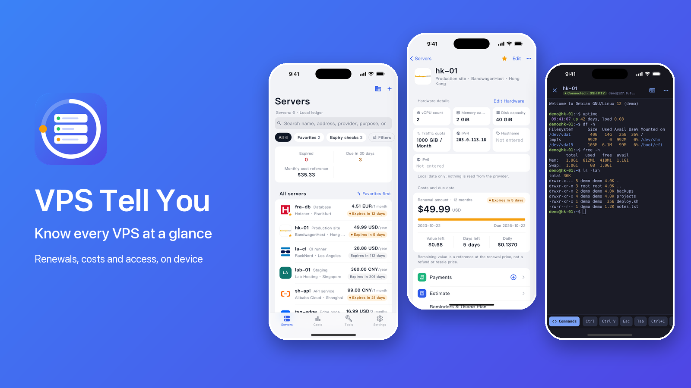

</div>

## Why

As the number of VPS grows, the details scatter: which provider, when it expires, what it costs, how you log in. They end up in notes, spreadsheets and old emails. VPS Tell You keeps them in one app, and only on your phone.

- **Local first**: data lives in SQLite on your device; the ledger starts empty and works offline.
- **No account**: nothing to sign up for, no cloud sync.
- **No telemetry**: no analytics, no ads, your ledger is never uploaded.
- **Fully open source**: MIT licensed; the code, the provider directory and the build scripts are all in this repository.

## Features

### Server ledger and providers

- Record name, IPv4 / IPv6 / hostname, purpose, specs and notes; search, groups, favorites, due-date filters and sorting
- Names, logos and descriptions of 88 cloud and VPS providers, searchable when you add a server; you can still create your own
- Archived servers can be restored; IPv4, IPv6 and hostname are independent and optional
- Simplified Chinese and English interface; light, dark or follow the system

<table>
  <tr>
    <td align="center">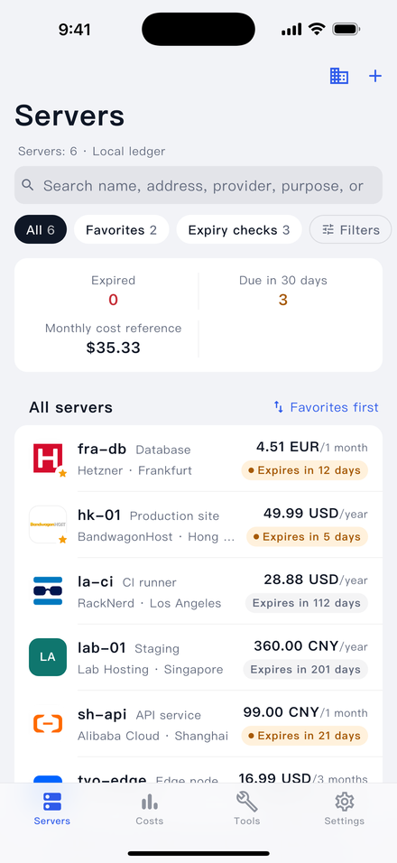<br>Server list</td>
    <td align="center">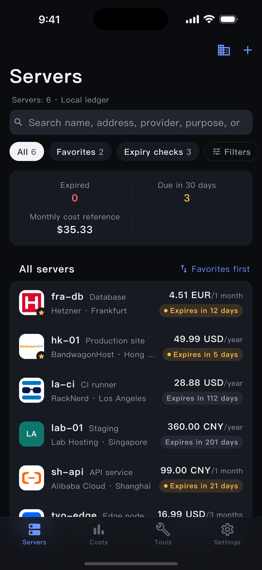<br>Dark theme</td>
    <td align="center">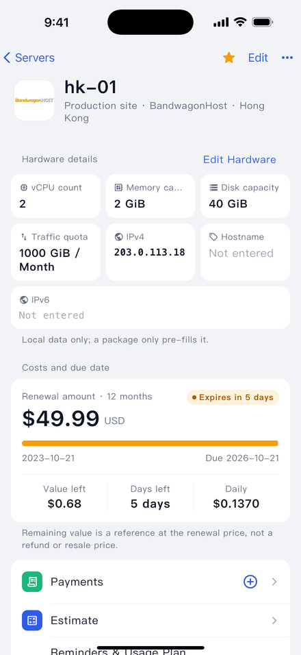<br>Server detail</td>
  </tr>
  <tr>
    <td align="center">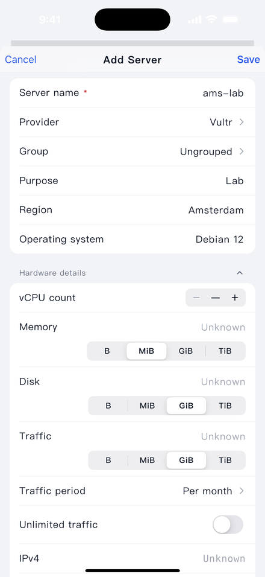<br>Add a server</td>
    <td align="center">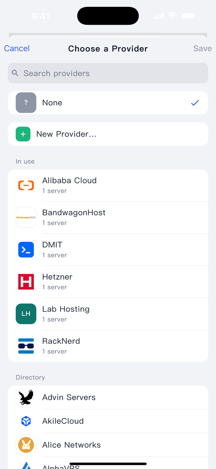<br>Provider picker</td>
    <td></td>
  </tr>
</table>

### Costs, renewals and reminders

- Cost overview: subtotals in original currencies, known / unknown coverage, provider and group breakdowns, 30-day and six-month forecasts
- Record a payment and renew 1–3 cycles, with duplicate-submit protection and safe undo; it only keeps records and never pays a provider
- Manual USD / EUR to CNY reference rates; the remaining-value calculator supports quotes and fees, and can copy text or save a PNG
- Per-server expiry reminders as local notifications that never include names, addresses or amounts

<table>
  <tr>
    <td align="center">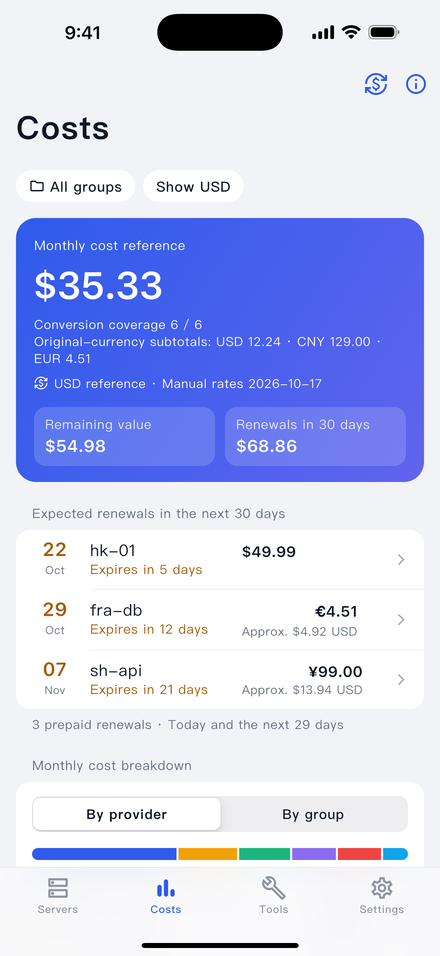<br>Costs</td>
    <td align="center">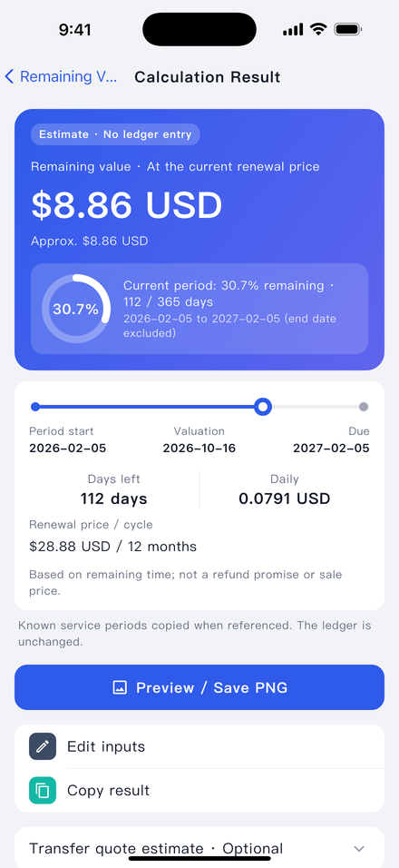<br>Remaining value</td>
    <td align="center">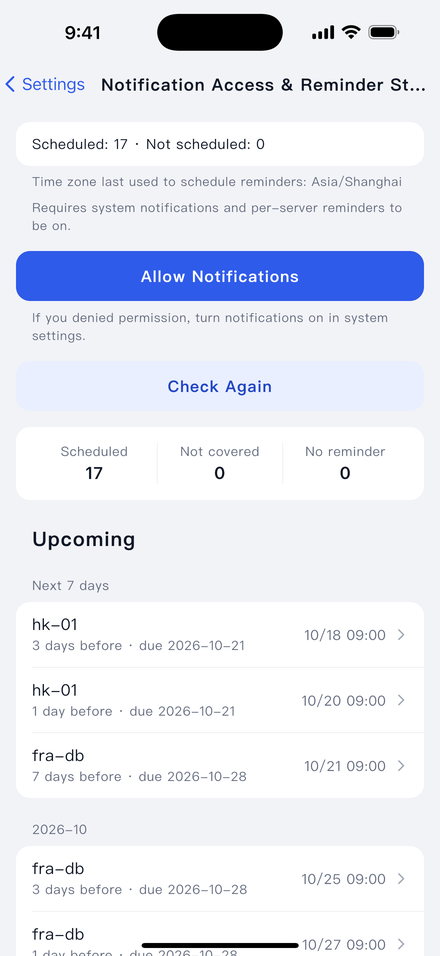<br>Reminders</td>
  </tr>
</table>

### SSH terminal, SFTP and TCP test

- Full-screen xterm terminal: password or key login (including encrypted keys), a special-keys row, command snippets, manual reconnect
- 4 terminal color schemes; prompts, IPs, paths and errors are colored automatically and the text is left untouched
- SFTP file manager: browse, upload, download, rename, move and delete, plus a text editor with syntax highlighting
- Single-target TCP test; SSH, SFTP and TCP all work with IPv6
- Host keys must be confirmed on first connect, and a changed key blocks the connection

<table>
  <tr>
    <td align="center">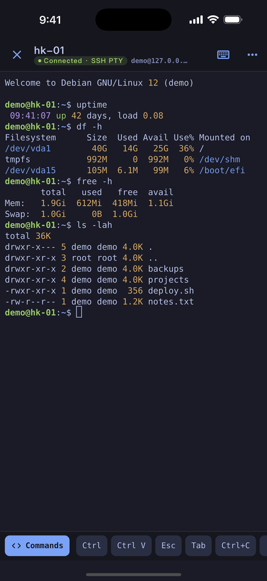<br>SSH terminal</td>
    <td align="center">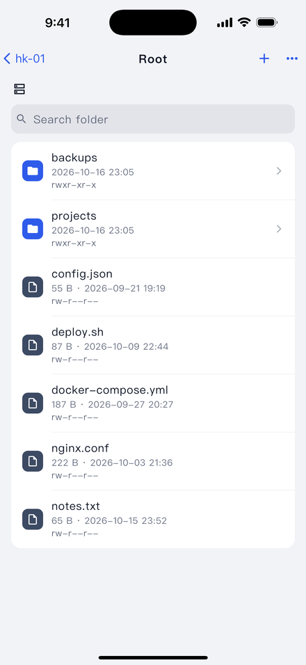<br>SFTP files</td>
    <td align="center">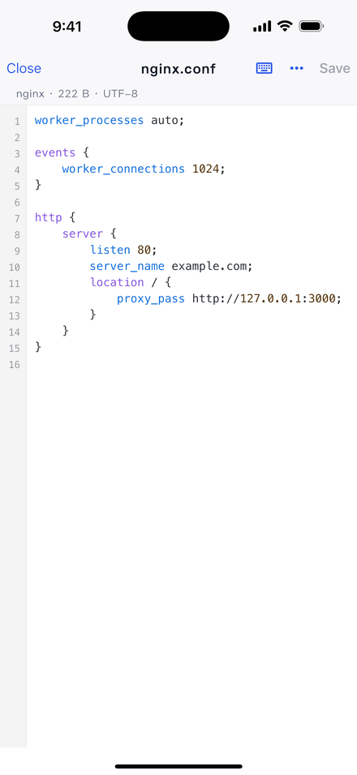<br>Text editor</td>
  </tr>
  <tr>
    <td align="center">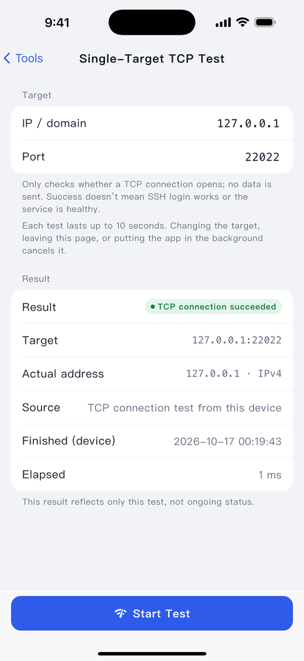<br>TCP test</td>
    <td></td>
    <td></td>
  </tr>
</table>

### Settings, backup and About

- JSON ledger export (with a preview of what is included) and restore into an empty ledger
- Providers, language, appearance and reminder permission live in Settings; About has the changelog, license and open-source components

<table>
  <tr>
    <td align="center">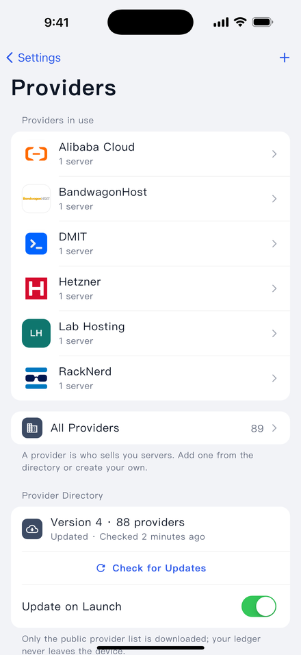<br>Settings › Providers</td>
    <td align="center">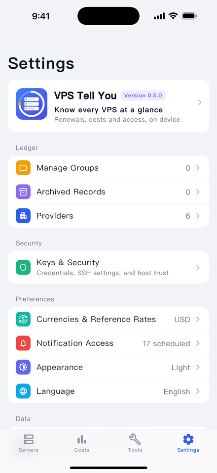<br>Settings</td>
    <td align="center">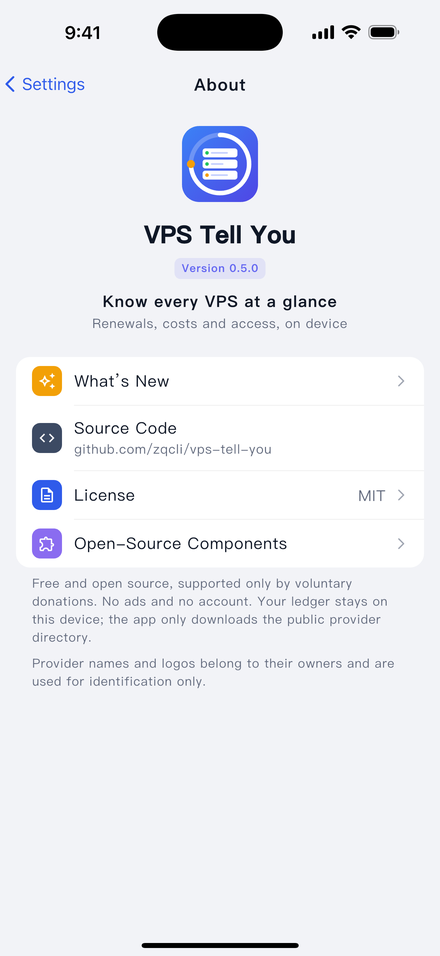<br>About</td>
  </tr>
</table>

## See it in action

<table>
  <tr>
    <td align="center">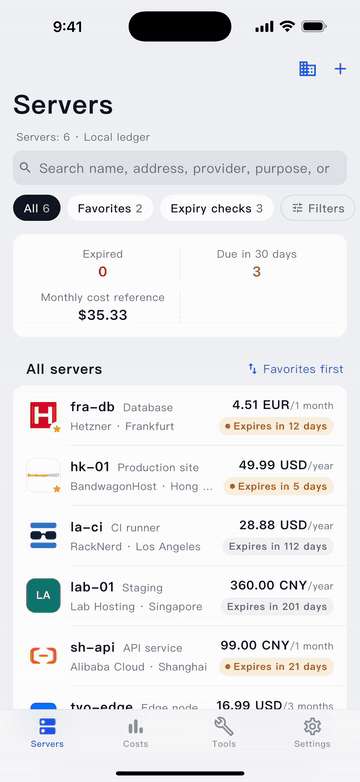<br>Add a server: search and pick a provider</td>
    <td align="center">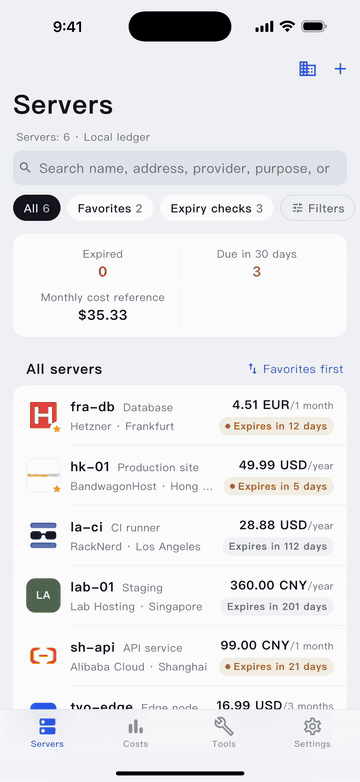<br>SSH: trust the host key, run commands, switch colors</td>
    <td align="center">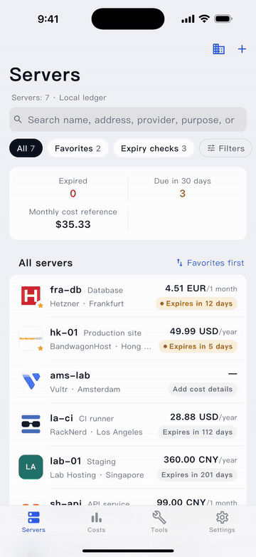<br>Record a renewal and see the new due date</td>
  </tr>
</table>

## Privacy and safety

- **No account, no telemetry.** Apart from the SSH / SFTP / TCP connections you start yourself, the only network request is downloading the public provider directory (`catalog/` in this repository, from GitHub raw with a jsDelivr mirror). The request carries no ledger data. Update-on-launch can be turned off in Settings › Providers.
- **SSH passwords and keys live only in the device's secure storage** (iOS Keychain / Android Keystore). Viewing them needs device authentication, and they are never exported.
- **A changed host key blocks the connection** until you verify it again.
- **JSON backups are not encrypted, and they contain no credentials.** Names, addresses and costs are plain text, so store the file carefully.
- **Archiving is not cancelling.** Archiving a server in the app does not cancel the service with the provider or stop billing.
- **Payments are bookkeeping.** The app never pays anyone.
- **Valuations and FX rates are for reference only.** They are computed from the figures you enter and are not quotes.

For the full boundaries see the [developer guide](docs/DEVELOPMENT.md) (Chinese) and the wiki's Security and Privacy page.

## Install

There are **no prebuilt binaries yet**; the v0.5.0 release is source-only. You build the app from source with Flutter 3.47.6 (stable).

```sh
git clone https://github.com/zqcli/vps-tell-you.git
cd vps-tell-you
flutter pub get --enforce-lockfile
```

- **iOS** (iOS 15 or later): requires macOS and Xcode. Open `ios/Runner.xcworkspace`, pick your Apple ID's Team under Signing & Capabilities (change the Bundle Identifier to your own if needed), connect your iPhone and run a Release build. A free Personal Team signature **expires after 7 days**, after which the app must be re-signed and reinstalled; a paid developer account does not have this limit.
- **Android** (Android 7.0 / API 24 or later): install the Android SDK and JDK 17, then
  ```sh
  flutter build apk --release --target-platform android-arm64,android-x64
  ```
  The APK is signed with the debug key. It is fine for installing on your own device, but it is not a store-ready package.

Step-by-step instructions are on the wiki [Install](https://github.com/zqcli/vps-tell-you/wiki/Install-EN) page.

## Quick start

1. Open the app. The ledger starts empty.
2. Tap **+**, enter a name, search for and pick a provider, then save.
3. Fill in the due date and cost; set an expiry reminder for the server if you want one.
4. Add an SSH password or key for the server, verify and confirm the host key on first connect, then open the terminal.
5. After you renew with the provider, record the payment on the server; the due date moves forward.

More in the wiki [Quick-Start](https://github.com/zqcli/vps-tell-you/wiki/Quick-Start-EN) page.

## Provider directory

Provider names, logos and descriptions live in [`catalog/`](catalog/). They are not bundled with the app: it downloads and caches them, and uses the cache offline. Your provider is missing?

1. Add `provider.json` (and an optional `logo.png`) under `catalog/providers/<id>/`.
2. Run `python3 tool/build_catalog.py` to validate and regenerate `index.json`.
3. Open a pull request.

Field rules and logo requirements are in [catalog/README.md](catalog/README.md) (Chinese). PRs are welcome. Names and logos in the directory are trademarks or copyrights of their respective owners, used for identification only, and imply no affiliation or endorsement.

## Roadmap

These are plans, not promises:

- Prebuilt releases and TestFlight, so you don't have to build it yourself
- Persisting the terminal color scheme and highlighting switch (currently for the running session only)
- Growing the remote provider directory through pull requests

## Contributing

Issues and pull requests are welcome. Please read the [developer guide](docs/DEVELOPMENT.md) (Chinese) and the wiki [Contributing](https://github.com/zqcli/vps-tell-you/wiki/Contributing-EN) page first. Before submitting, run:

```sh
dart format --output=none --set-exit-if-changed lib test
flutter analyze
flutter test
python3 tool/build_catalog.py --check
```

The full SSH protocol tests need Python dependencies; see the developer guide for setup. Never commit real passwords, private keys, API tokens or user databases.

## Documentation

- [Wiki home](https://github.com/zqcli/vps-tell-you/wiki/Home-EN): installation, usage, FAQ
- [Changelog](CHANGELOG.en.md) ([中文](CHANGELOG.md))
- [Developer guide](docs/DEVELOPMENT.md) (Chinese): code layout, data rules, migrations, security boundaries, tests
- [`docs/`](docs/): [providers](docs/PROVIDERS.md), [IPv6](docs/IPV6.md), [SSH terminal](docs/SSH_TERMINAL_UX.md), [localization](docs/LOCALIZATION.md), [status](docs/STATUS.md) (Chinese)

## License

Released under the [MIT License](LICENSE), Copyright (c) 2026 zqcli and contributors. Third-party components keep their own licenses; see [docs/LICENSES.md](docs/LICENSES.md) for the audit, or Settings › About › Open-source components in the app for the full texts. Provider names and logos belong to their respective owners and are used for identification only.

## Support

VPS Tell You is free and open source, and accepts voluntary donations only. The donation link will be added here later.
