简体中文 | [English](README.en.md)

<div align="center">


# VPS Tell You

**本地优先的个人 VPS 台账：记账、到期提醒，顺手 SSH / SFTP。**

[](CHANGELOG.md)
[](https://github.com/zqcli/vps-tell-you/releases)
[](https://github.com/zqcli/vps-tell-you/actions/workflows/ci.yml)
[](LICENSE)
[](https://flutter.dev)
[](#安装)

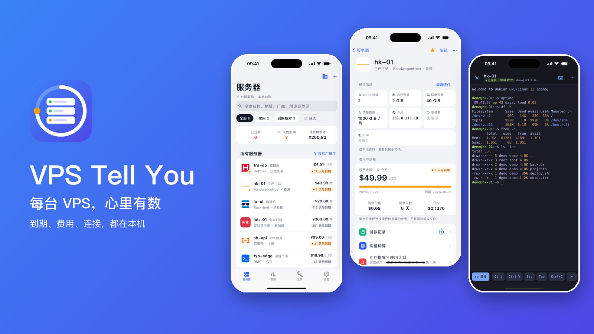

</div>

## 为什么做它

手里的 VPS 越来越多：谁家的、什么时候到期、花了多少钱、登录方式是什么，散落在备忘录、表格和邮件里。VPS Tell You 把这些放在一个应用里，并且只放在你的手机上。

- **本地优先**：数据保存在设备上的 SQLite，默认空台账，离线可用。
- **无需账号**：不用注册，没有云同步。
- **无遥测**：没有统计、没有广告，不上传台账。
- **完全开源**：MIT 许可证，代码、提供商目录和构建脚本都在这个仓库里。

## 功能亮点

### 服务器台账与提供商

- 记录名称、IPv4 / IPv6 / 主机名、用途、规格和备注；搜索、分组、常用、到期筛选与排序
- 内置 88 家云厂商与 VPS 商家的名称、Logo 和简介，新增时可搜索选择，也可以自建
- 归档后可恢复；IPv4、IPv6、主机名各自独立可选
- 简体中文 / English 界面，浅色 / 深色 / 跟随系统

<table>
  <tr>
    <td align="center"><br>服务器列表</td>
    <td align="center">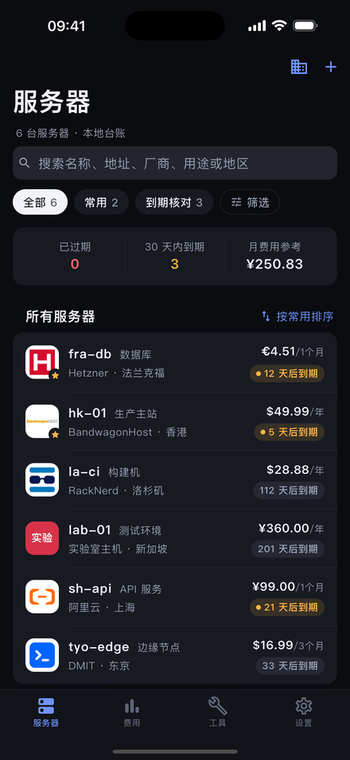<br>深色主题</td>
    <td align="center">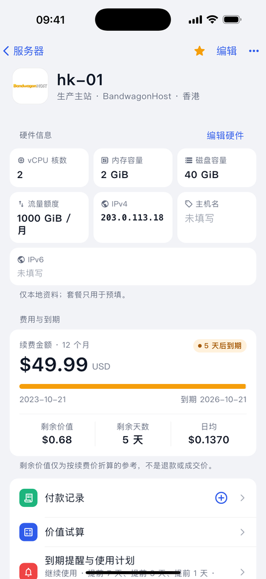<br>服务器详情</td>
  </tr>
  <tr>
    <td align="center">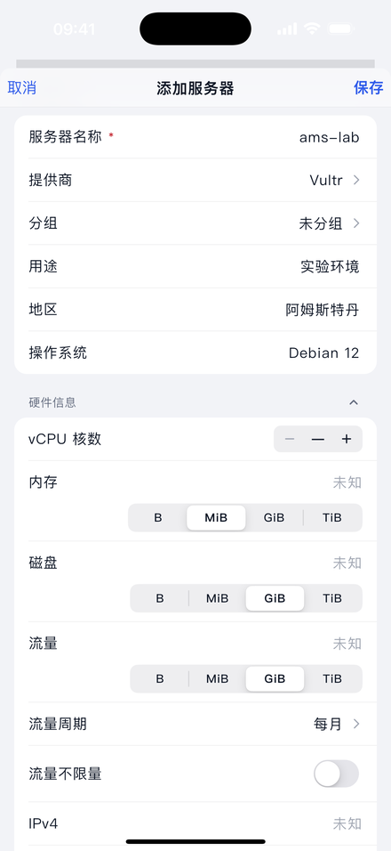<br>添加服务器</td>
    <td align="center">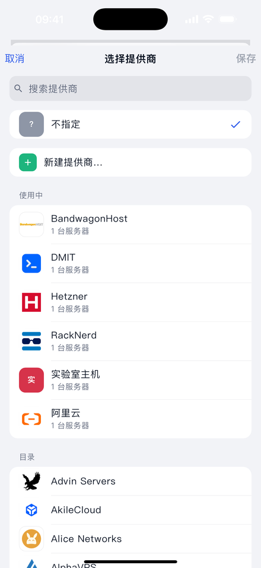<br>选择提供商</td>
    <td></td>
  </tr>
</table>

### 费用、续期与提醒

- 费用总览：原币小计、已知 / 未知覆盖率、提供商与分组分布，未来 30 天和六个月预测
- 记录付款并续期 1–3 个周期，防重复提交，可安全撤销；只记账，不向厂商付款
- 手动 USD / EUR 对 CNY 参考汇率；剩余价值计算器支持报价与手续费，可复制文字或保存 PNG
- 每台服务器独立设置到期提醒，本地通知，内容不含名称、地址和金额

<table>
  <tr>
    <td align="center">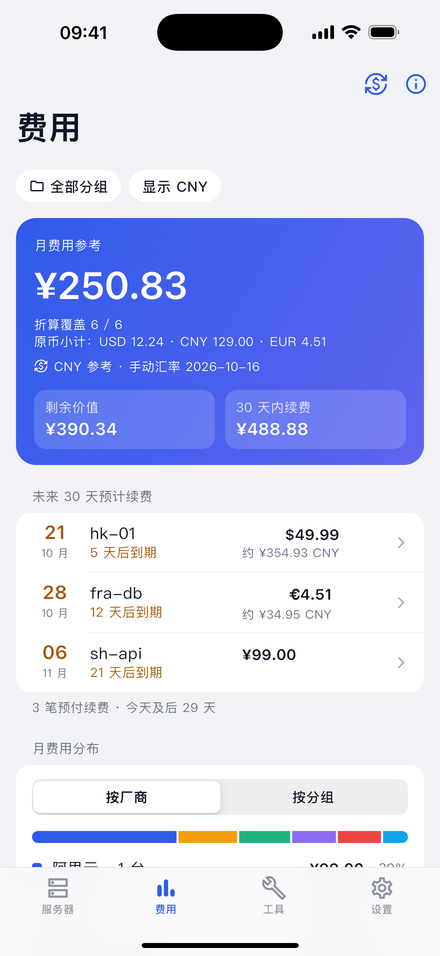<br>费用总览</td>
    <td align="center">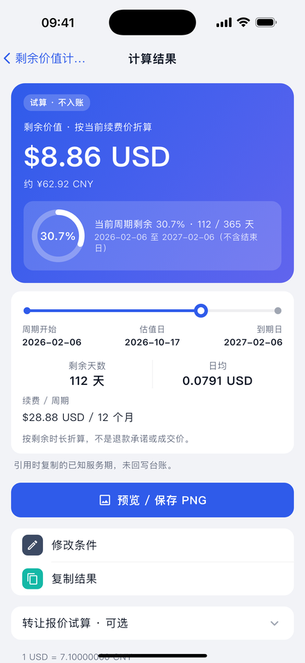<br>剩余价值计算</td>
    <td align="center">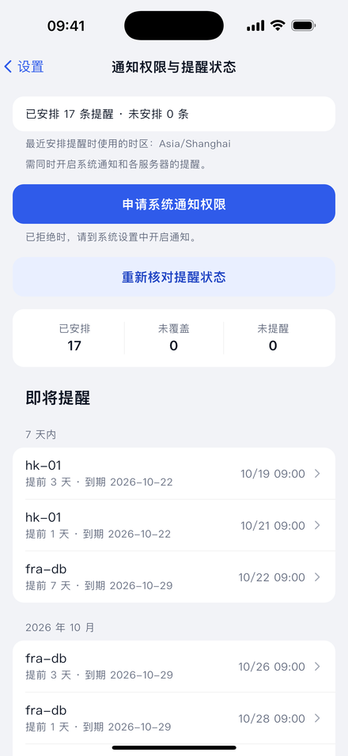<br>到期提醒</td>
  </tr>
</table>

### SSH 终端、SFTP 与 TCP 检测

- 全屏 xterm 终端：密码或私钥登录（含加密私钥）、特殊键行、命令片段
- 切到后台时 SSH 会保留一小段系统允许的时间（iOS 通常约 30 秒，Android 固定 30 秒），回来原样继续，超时才断开
- 4 套终端配色，提示符、IP、路径、错误等自动着色，不改动文字内容
- SFTP 文件管理：浏览、上传、下载、重命名、移动、删除，以及带语法高亮的文本编辑器
- 单目标 TCP 检测；SSH、SFTP、TCP 都支持 IPv6
- 主机公钥首次连接需确认，公钥变化时阻止连接

<table>
  <tr>
    <td align="center">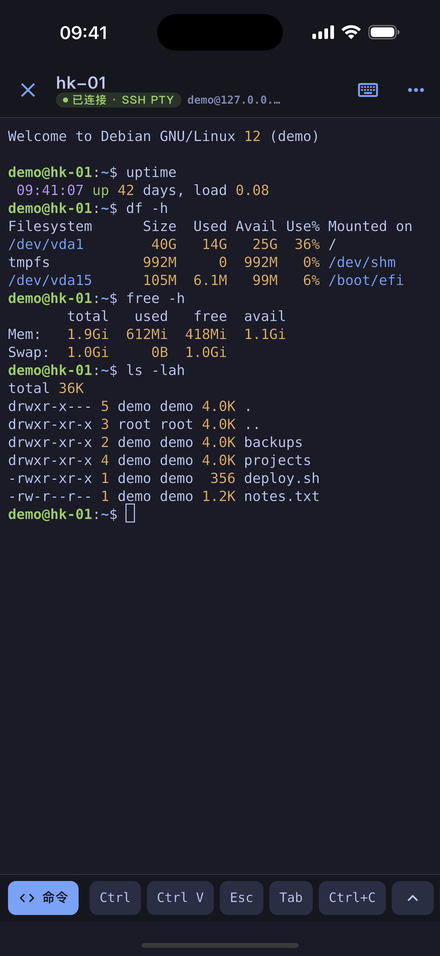<br>SSH 终端</td>
    <td align="center">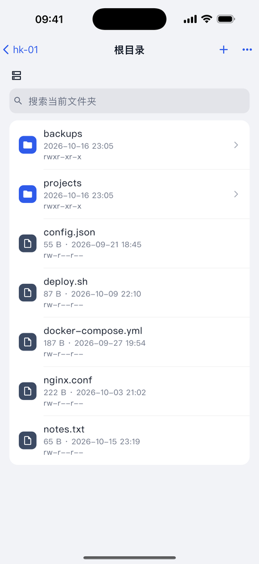<br>SFTP 文件</td>
    <td align="center">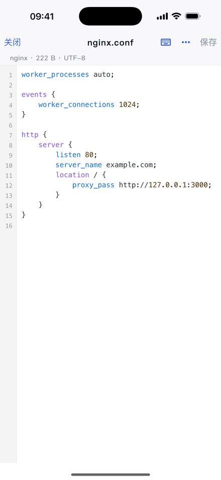<br>文本编辑器</td>
  </tr>
  <tr>
    <td align="center">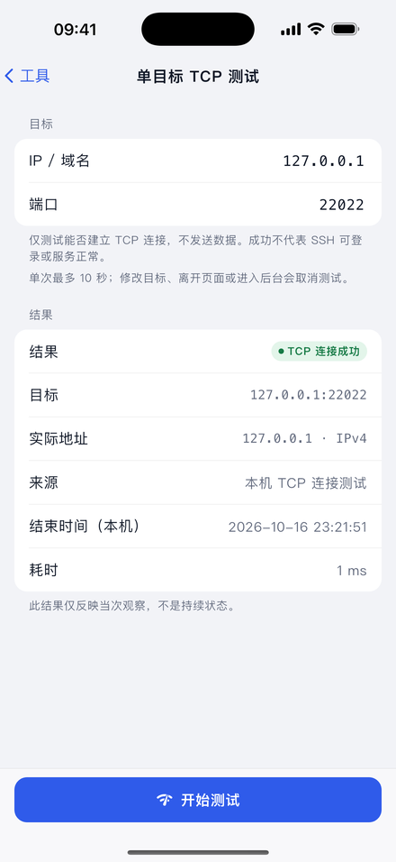<br>TCP 检测</td>
    <td></td>
    <td></td>
  </tr>
</table>

### 设置、备份与关于

- JSON 台账导出（先预览范围）与空台账恢复
- 提供商页、语言、外观、提醒权限集中在设置；关于页含更新记录、许可证和开源组件

<table>
  <tr>
    <td align="center">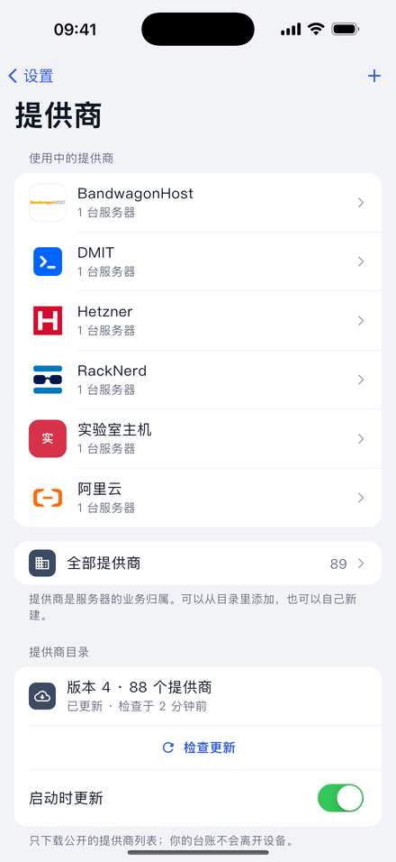<br>设置 › 提供商</td>
    <td align="center">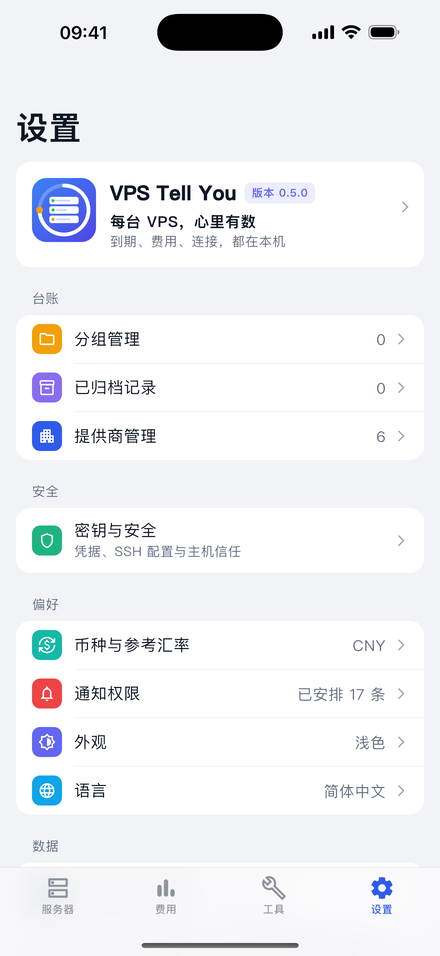<br>设置</td>
    <td align="center">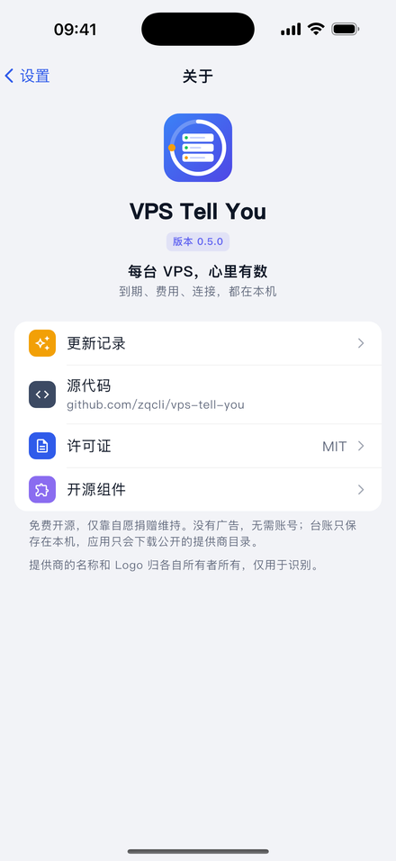<br>关于</td>
  </tr>
</table>

## 动图演示

<table>
  <tr>
    <td align="center">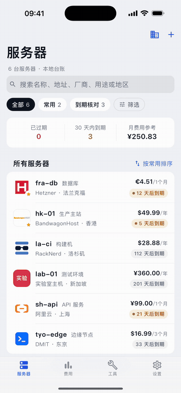<br>添加服务器：搜索并选择提供商</td>
    <td align="center"><br>SSH：确认主机公钥、运行命令、切换配色</td>
    <td align="center">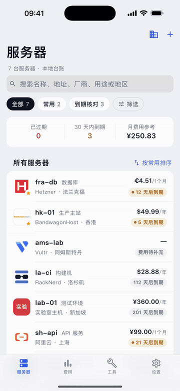<br>记录续期，查看新的到期日</td>
  </tr>
</table>

## 隐私与安全

- **没有账号，没有遥测。** 除你主动发起的 SSH / SFTP / TCP 连接外，应用唯一的网络请求是下载公开的提供商目录（本仓库的 `catalog/`，经 GitHub raw，jsDelivr 作镜像），请求不含任何台账数据。启动时更新可在「设置 / 提供商」关闭。
- **SSH 密码和私钥只存放在设备的安全存储中**（iOS Keychain / Android Keystore），查看需要设备验证，永远不会被导出。
- **主机公钥变化会阻止连接**，必须重新核实后才能继续。
- **JSON 备份没有加密，但也不含任何凭据。** 其中的名称、地址、费用等是明文，请妥善保存。
- **归档不等于取消。** 在应用里归档服务器，不会取消厂商的服务，也不会停止扣费。
- **付款只是记账。** 应用不会向任何人付款。
- **估值与汇率仅供参考。** 剩余价值和汇率由你手动填写的数据计算，不是报价。

完整边界见 [开发者指南](docs/DEVELOPMENT.md) 与 Wiki 的「安全与隐私」页。

## 安装

目前**没有预编译安装包**；v0.5.0 发布是仅源码的。需要从源码构建，使用 Flutter 3.47.6（stable）。

```sh
git clone https://github.com/zqcli/vps-tell-you.git
cd vps-tell-you
flutter pub get --enforce-lockfile
```

- **iOS**（最低 iOS 15）：需要 macOS 和 Xcode。用 Xcode 打开 `ios/Runner.xcworkspace`，在 Signing & Capabilities 选择你的 Apple ID 对应的 Team（必要时把 Bundle Identifier 改成你自己的），连接 iPhone 后运行 Release。免费的 Personal Team 签名**7 天后过期**，到期需要重新签名安装；付费开发者账号不受此限制。
- **Android**（最低 Android 7.0，API 24）：安装 Android SDK 和 JDK 17，然后
  ```sh
  flutter build apk --release --target-platform android-arm64,android-x64
  ```
  生成的 APK 使用调试密钥签名，适合自用安装，不是商店发布包。

详细步骤见 Wiki 的 [Install](https://github.com/zqcli/vps-tell-you/wiki/Install) 页。

## 快速开始

1. 打开应用，台账默认是空的。
2. 点 **+**，填写名称，搜索并选择提供商，保存。
3. 补全到期日与费用；需要提醒时为这台服务器设置到期提醒。
4. 为服务器添加 SSH 密码或私钥，首次连接时核对并确认主机公钥，然后打开终端。
5. 续费后在服务器详情记录付款，到期日会随之顺延。

更多说明见 Wiki 的 [Quick-Start](https://github.com/zqcli/vps-tell-you/wiki/Quick-Start)。

## 提供商目录

提供商的名称、Logo 和简介保存在仓库的 [`catalog/`](catalog/)，不随应用打包，由应用下载并缓存；离线时使用缓存。目录里没有你的提供商？

1. 在 `catalog/providers/<id>/` 新增 `provider.json`（可选 `logo.png`）。
2. 运行 `python3 tool/build_catalog.py` 校验并生成 `index.json`。
3. 提交 Pull Request。

字段规则和 Logo 要求见 [catalog/README.md](catalog/README.md)，欢迎 PR。目录中的名称和 Logo 属于各自所有者的商标或版权，仅用于识别，与其所有者没有隶属或背书关系。

## 路线图

以下是计划，不是承诺：

- 预编译发布与 TestFlight，免去自行构建
- 终端配色与高亮开关的持久化（目前仅本次运行有效）
- 通过 Pull Request 持续扩充远程提供商目录

## 参与贡献

欢迎提 Issue 和 Pull Request。开发前请先阅读 [开发者指南](docs/DEVELOPMENT.md) 与 Wiki 的 [Contributing](https://github.com/zqcli/vps-tell-you/wiki/Contributing) 页。提交前请运行：

```sh
dart format --output=none --set-exit-if-changed lib test
flutter analyze
flutter test
python3 tool/build_catalog.py --check
```

完整的 SSH 协议测试需要 Python 依赖，安装方式见开发者指南。请不要提交真实密码、私钥、API Token 或用户数据库。

## 文档

- [Wiki 首页](https://github.com/zqcli/vps-tell-you/wiki)：安装、使用说明、FAQ
- [更新记录](CHANGELOG.md)（[English](CHANGELOG.en.md)）
- [开发者指南](docs/DEVELOPMENT.md)：代码结构、数据规则、迁移、安全边界、测试
- [`docs/`](docs/)：[提供商](docs/PROVIDERS.md)、[IPv6](docs/IPV6.md)、[SSH 终端](docs/SSH_TERMINAL_UX.md)、[本地化](docs/LOCALIZATION.md)、[状态](docs/STATUS.md)

## 许可证

以 [MIT 许可证](LICENSE) 发布，Copyright (c) 2026 zqcli and contributors。第三方组件保留各自的许可证，逐项核对见 [docs/LICENSES.md](docs/LICENSES.md)，应用内「设置 / 关于 / 开源组件」可查看全文。提供商名称和 Logo 属于各自所有者，仅用于识别。

## 支持

VPS Tell You 免费、开源，只接受自愿捐赠。捐赠链接稍后会添加到这里。
